<!-- Header -->
<p align="center">
  
</p>

<p align="center">
  <a href="https://git.io/typing-svg">
    
  </a>
</p>

<p align="center">
  <a href="https://www.linkedin.com/in/gayashan-indrasankha/"></a>
  <a href="mailto:gayashanindrasankha@gmail.com"></a>
  <a href="https://x.com/indrasankhaG"></a>
  <a href="https://wa.me/+94753800728"></a>
  
</p>

---

## 👨‍💻 About Me

I'm an IT undergraduate at the **University of Colombo School of Computing**, building toward one goal: **becoming an AI Engineer who can take LLM systems all the way to production**. My plan is simple: first become a solid software engineer, then own the cloud my code runs on, then bring AI into products people actually use.

```yaml
now:        IT Undergraduate @ UCSC  →  Software Engineer
target:     AI Engineer building LLM systems in production
learning:   DSA · advanced SQL · Docker in production · REST API design · deeper Python
shipping:   BizFlows, a workflow automation engine (going live)
edge:       software + cloud + AI, so I can ship AI features end to end
open_to:    Software Engineering internships & graduate roles
```

---

## 🧪 Proof of Work

**🤖 AI & Data: where I'm heading**

| Project | What it shows | Stack |
|:--|:--|:--|
| **[LLM Eval Framework](https://github.com/gayashan-indrasankha/llm-eval-framework)** | Reproducible benchmark of Claude vs Microsoft Copilot on GRC policy questions, with deterministic prompts, a six-dimension rubric and comparative analysis. The seed of my eval work. | Python · Excel |
| **[GRC Risk Monitor](https://github.com/gayashan-indrasankha/grc-risk-monitor)** | Turns business policies into SQL control rules, a Power BI dashboard and automated alerts, with 28 recorded tests. | Python · SQLite · Power BI · Power Automate |
| **[Skill-to-Career Predictor](https://github.com/gayashan-indrasankha/AI-Driven-Skill-to-Career-Pathway-Predictor)** | Matches student skills to Sri Lanka–relevant career paths using weighted scoring and market signals. | MongoDB · Express · React · Node.js |

**⚙️ Software Engineering: the foundation**

| Project | What it shows | Stack |
|:--|:--|:--|
| **[LifeOS](https://github.com/gayashan-indrasankha/LifeOS)** · [live app](https://lifeos-gayashan-2026.vercel.app) | Personal planning system connecting long-term goals to weekly plans, daily tasks and habits. Built solo, with unit, integration and browser tests running in GitHub Actions. | Next.js · TypeScript · PostgreSQL · Electron |
| **[Zinema.lk](https://github.com/gayashan-indrasankha/Zinema.lk)** | Built solo to make movies affordable in Sri Lanka: one-time tokens deliver films through low-cost WhatsApp packages instead of expensive mobile data, with a short-clip feed for discovery. | PHP · MySQL · JavaScript · Node.js |
| **[SwiftTrack Middleware](https://github.com/gayashan-indrasankha/Middleware-Architecture-for-SwiftLogistics)** | API gateway bridging SOAP, REST and TCP systems with saga coordination, so no order is lost when a service goes down. | Node.js · Python · PostgreSQL · Docker |
| **[NexBus](https://github.com/gayashan-indrasankha/NexBus)** | Role-based bus tracking and fleet management system for Sri Lankan transport. | PHP · MySQL · JavaScript |
| **BizFlows** · *going live soon* | Application engine for automating business workflows. It will be the base for my first LLM-powered workflow step. | TypeScript |

---

## 🗺️ My Route to AI Engineer

<p align="center">
  
</p>

**Right now:** finishing my degree, practising DSA and advanced SQL, and getting BizFlows live with a public demo.

**My one rule:** every stop ends with something deployed and used, not another tutorial.

---

## 🛠️ Skills by Track

<p align="center"><b>⚙️ Software Engineering</b> (using)</p>
<p align="center">
  
</p>

<p align="center"><b>☁️ Cloud & DevOps</b> (using → learning)</p>
<p align="center">
  
</p>

<p align="center"><b>🤖 AI Engineering</b> (learning)</p>
<p align="center">
  
  
  
  
  
  
</p>

---

## 📊 GitHub Analytics

<table align="center">
  <tr>
    <td></td>
    <td></td>
  </tr>
</table>

<p align="center">
  
</p>

<!-- Footer -->
<p align="center">
  
</p>
