<!-- Header -->

  

  

  
  
  
  
  

---

## 👨‍💻 About Me

  

  Information Systems undergraduate from Sri Lanka. I turn manual, time-heavy business processes 
  into tested automation and software, and I <b>measure AI output</b> instead of trusting it.

  <a href="https://github.com/gayashan-indrasankha/LifeOS"></a>
  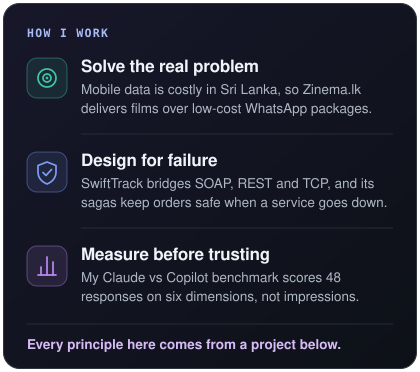
  
  <a href="mailto:gayashanindrasankha@gmail.com"></a>

---

## 🧪 Proof of Work

  <a href="https://github.com/gayashan-indrasankha/llm-eval-framework">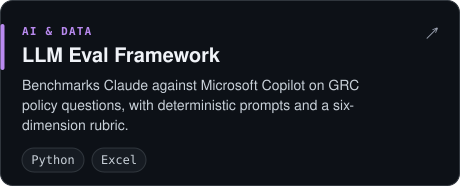</a>
  <a href="https://github.com/gayashan-indrasankha/grc-risk-monitor">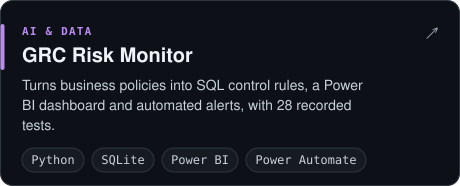</a>
  <a href="https://github.com/gayashan-indrasankha/AI-Driven-Skill-to-Career-Pathway-Predictor">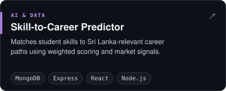</a>
  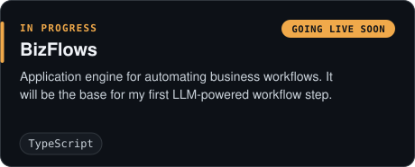
  <a href="https://github.com/gayashan-indrasankha/LifeOS">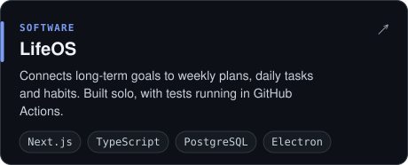</a>
  <a href="https://github.com/gayashan-indrasankha/Zinema.lk">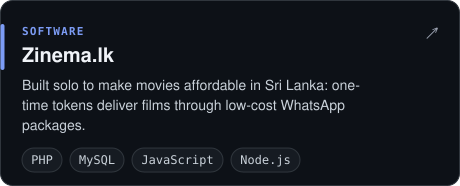</a>
  <a href="https://github.com/gayashan-indrasankha/Middleware-Architecture-for-SwiftLogistics">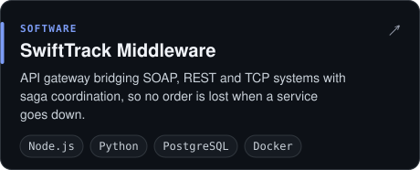</a>
  <a href="https://github.com/gayashan-indrasankha/NexBus">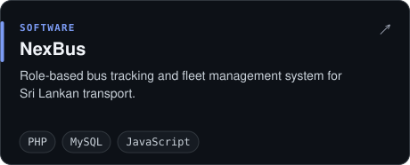</a>

---

## 🗺️ My Route to AI Engineer

  

**Right now:** finishing my degree, learning Copilot Studio and agentic AI workflows, and getting BizFlows live with a public demo.

**My one rule:** every stop ends with something deployed and used, not another tutorial.

---

## 🛠️ Skills by Track

<b>📊 AI, Data & Automation</b> (using)

  
  
  
  
  
  
  

<b>⚙️ Software Engineering</b> (using)

  

<b>☁️ Cloud & DevOps</b> (using → learning)

  

<b>🤖 AI Engineering</b> (learning)

  
  
  
  
  
  
  

---

## 📊 GitHub Analytics

<table align="center">
  <tr>
    <td></td>
    <td></td>
  </tr>
</table>

  <a href="https://github.com/gayashan-indrasankha?tab=overview">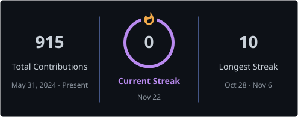</a>

<!-- The stats, top-languages and streak SVGs are generated by .github/workflows/streak-stats.yml.
     Keeping the images in this repository preserves the last successful cards if a refresh fails. -->

<!-- Footer -->

  

